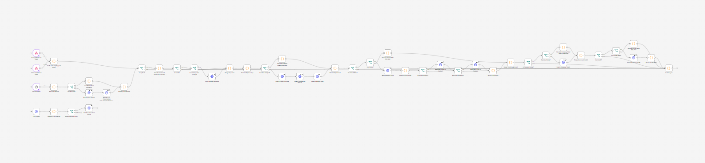
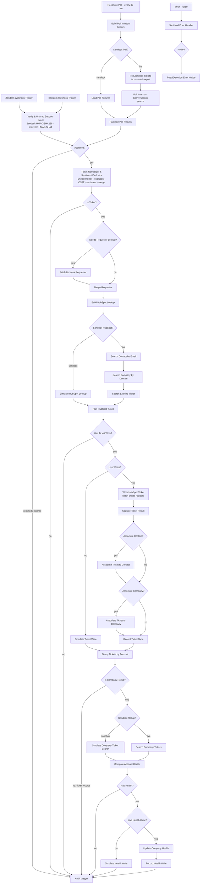

# n8n-zendesk-intercom-hubspot-unified-ticket-health-sync

**Zendesk tickets and Intercom conversations → one unified ticket model → HubSpot tickets on the right contact and company → account health properties (open backlog, resolution time, CSAT, sentiment grade, health score) that sales and success teams can actually see.**

I built this n8n workflow for revenue teams whose support data lives outside HubSpot. An account can have three urgent Zendesk tickets and an angry Intercom thread while its renewal is in the CRM marked "healthy". This workflow takes support events from both platforms, through signed webhooks plus a reconciliation poll. It normalises them into one model, creates or updates a HubSpot ticket for each one with metadata only, and then recomputes the company's support health from every synced ticket on that account.

> **Safe by default.** `SANDBOX_MODE=true` and `DRY_RUN=true`. Out of the box, the workflow runs only against pinned fictional Zendesk, Intercom and poll data. It makes no Zendesk, Intercom or HubSpot calls until you turn both switches off.

Built by DH Robin · dhRobin Systems · MIT licensed.

---

## Table of Contents

1. [Why this exists](#1-why-this-exists)
2. [Architecture](#2-architecture)
3. [Repository layout](#3-repository-layout)
4. [Quick start](#4-quick-start)
5. [Zendesk event handling](#5-zendesk-event-handling)
6. [Intercom event handling](#6-intercom-event-handling)
7. [Reconciliation poll](#7-reconciliation-poll)
8. [Unified ticket model & sentiment](#8-unified-ticket-model--sentiment)
9. [HubSpot ticket mapping](#9-hubspot-ticket-mapping)
10. [Account health property calculations](#10-account-health-property-calculations)
11. [Environment variables](#11-environment-variables)
12. [Node configuration](#12-node-configuration)
13. [Testing stages](#13-testing-stages)
14. [Security & privacy model](#14-security--privacy-model)
15. [Troubleshooting](#15-troubleshooting)
16. [Known limitations](#16-known-limitations)
17. [Disclaimer & license](#17-disclaimer--license)

---

## 1. Why this exists

When support runs in Zendesk and Intercom but revenue runs in HubSpot:

- **AEs and CSMs walk into calls blind.** They don't know about the outage ticket from yesterday.
- **Two support tools mean two partial pictures.** Nobody adds them up per account.
- **Health scores ignore support,** or rely on a weekly export that's already stale.
- **Copying whole conversations into the CRM** is a privacy problem waiting to happen.

My answer: sync **ticket metadata, not conversations**, key every record on a stable external ID so replays are harmless, and compute account health from all synced tickets in HubSpot. One late webhook then can't skew the score.

## 2. Architecture





| Required component | Nodes |
|---|---|
| 1 · Webhook Triggers / API Pollers | `Zendesk Webhook Trigger`, `Intercom Webhook Trigger`, `Reconcile Poll` → `Poll Zendesk Tickets`, `Poll Intercom Conversations` (pinned fictional data on all three triggers) |
| 2 · Ticket Normalizer & Sentiment Evaluator | `Verify & Unwrap Support Event`, `Ticket Normalizer & Sentiment Evaluator`, `Merge Requester`, `Group Tickets by Account` |
| 3 · HubSpot Ticket & Account Health Engine | the three searches, `Plan HubSpot Ticket`, `Write HubSpot Ticket`, both association nodes, `Search Company Tickets`, `Compute Account Health`, `Update Company Health` (sandbox / dry run: the simulators) |
| 4 · Audit Logger & Sanitized Error Handler | `Audit Logger`, `Sanitized Error Handler` |

## 3. Repository layout

```
n8n-zendesk-intercom-hubspot-unified-ticket-health-sync/
├── README.md        ← this file
├── workflow.json    ← import into n8n (inactive, sandbox defaults, pinned fixtures on all triggers)
├── DISCLAIMER.md
└── LICENSE          ← MIT
```

All logic lives in Code nodes inside `workflow.json`. There are no community nodes and no stored n8n credentials. Every secret comes from an environment variable.

## 4. Quick start

1. In n8n, go to **Workflows → Import from File** and select `workflow.json`. The workflow imports **inactive**.
2. Run each trigger with its pinned data: open **Zendesk Webhook Trigger**, **Intercom Webhook Trigger** or **Reconcile Poll** and click *Execute step*, or choose the trigger when you execute the workflow.
3. Open **Audit Logger** and compare the records with [Stage 1](#stage-1--sandbox-pinned-fixtures-no-network).
4. Open **Simulate Ticket Write (Dry Run)** and **Simulate Health Write (Dry Run)** to see the HubSpot properties that would be written.

### n8n platform prerequisites

| Setting | Why |
|---|---|
| `N8N_BLOCK_ENV_ACCESS_IN_NODE=false` | Code nodes and expressions read configuration through `$env`. If access is blocked, the helpers fall back to the safe defaults. |
| `NODE_FUNCTION_ALLOW_BUILTIN=crypto` | Needed for HMAC and constant-time comparison. Without it, every delivery is rejected. |
| Concurrency of 1 for this workflow | Event ledger and poll cursors live in static data, which isn't transactional. |
| Settings → Error Workflow = this workflow | Activates the sanitized error branch. |

## 5. Zendesk event handling

### 5.1 Verification

Zendesk signs each webhook request with `X-Zendesk-Webhook-Signature = base64(HMAC-SHA256(signing_secret, timestamp + raw_body))` and sends the timestamp in `X-Zendesk-Webhook-Signature-Timestamp`. The verifier rebuilds this from the raw body (the trigger has *Raw Body* on) and compares in constant time. Outside the sandbox it also rejects timestamps older than `SIGNATURE_TOLERANCE_SECONDS` (600). Copy the signing secret from the webhook's page in Admin Center into `ZENDESK_WEBHOOK_SECRET`.

### 5.2 Two ways to connect Zendesk

**A · Event webhook (recommended for status changes).** Subscribe the webhook to these events:

- `zen:event-type:ticket.created`
- `zen:event-type:ticket.status_changed`
- `zen:event-type:ticket.priority_changed`
- `zen:event-type:ticket.organization_changed`
- `zen:event-type:ticket.csat_received`

Payloads carry `detail` (`id`, `subject`, `status`, `priority`, `requester_id`, `organization_id`, `created_at`, `updated_at`, …) and `event` (the change). Because the payload has no requester e-mail, the workflow calls `GET /api/v2/users/{requester_id}.json` (Basic auth `email/token:api_token`) and keeps only the e-mail and name. CSAT events are read from `event.current.score` (or `rating`/`value`). I couldn't confirm that exact sub-structure, so check one real delivery.

**B · Trigger webhook (recommended for CSAT and sentiment).** A Zendesk trigger with the action *Notify webhook* and this JSON body. The placeholder names are from Zendesk's placeholder reference, so verify them in your account:

```json
{
  "event": "updated",
  "occurred_at": "{{ticket.updated_at_with_timestamp}}",
  "ticket": {
    "id": "{{ticket.id}}",
    "subject": "{{ticket.title}}",
    "status": "{{ticket.status}}",
    "priority": "{{ticket.priority}}",
    "channel": "{{ticket.via}}",
    "created_at": "{{ticket.created_at_with_timestamp}}",
    "updated_at": "{{ticket.updated_at_with_timestamp}}",
    "requester": { "email": "{{ticket.requester.email}}", "name": "{{ticket.requester.name}}" },
    "organization": { "name": "{{ticket.organization.name}}", "domain": "" },
    "satisfaction": { "score": "{{satisfaction.current_rating}}" },
    "sentiment": "{{ticket.ticket_field_YOUR_SENTIMENT_FIELD_ID}}"
  }
}
```

The `sentiment` line is optional. Use it if Zendesk intelligent triage, or any sentiment field, is available on your plan. Values like `very_negative … very_positive` are understood.

Processed event types are set with `ZENDESK_EVENT_TYPES`. Anything else is acknowledged and ignored.

## 6. Intercom event handling

Intercom signs every notification with `X-Hub-Signature: sha1=<hex>`, an **HMAC-SHA1** of the raw body keyed with your app's **client secret** (Developer Hub → Basic information), not the access token. Store that secret in `INTERCOM_CLIENT_SECRET`. The `ping` topic sent when you save the webhook is acknowledged.

Subscribe to these topics (`INTERCOM_TOPICS`):

- `conversation.user.created`
- `conversation.admin.closed`, `conversation.admin.opened`, `conversation.admin.snoozed`, `conversation.admin.replied`
- `conversation.rating.added`
- `conversation.priority.updated`
- `ticket.created`, `ticket.state.updated`

The resource is read from `data.item`:

| Field | Source |
|---|---|
| Status | `state` (`open` → open, `snoozed` → on hold, `closed` → resolved), or `ticket_state` for Intercom tickets |
| Priority | `priority` |
| Requester | `source.author.{email, name}` |
| Timings | `created_at`, `statistics.first_admin_reply_at`, `statistics.last_close_at` |
| CSAT | `conversation_rating.rating` (1–5) |
| Sentiment (optional) | `custom_attributes[INTERCOM_SENTIMENT_ATTRIBUTE]` |

The rating remark and the message bodies are **never read into the output**.

Intercom doesn't sign a timestamp, so there's no replay window for Intercom deliveries. Replays are made harmless by the event ledger and by keying every HubSpot ticket on `intercom:<id>`.

## 7. Reconciliation poll

Webhooks get lost. **Reconcile Poll** runs every 30 minutes:

- **Zendesk:** `GET https://{subdomain}.zendesk.com/api/v2/incremental/tickets/cursor.json` with `start_time` on the first run, then `cursor=after_cursor`, and `include=users,organizations` so requester e-mails and organisation domains arrive in the same call.
- **Intercom:** `POST https://api.intercom.io/conversations/search` for `updated_at > last seen` (header `Intercom-Version`, default `2.11`).

Poll results use the same envelope as webhooks and go through the same normaliser, so an event seen by both paths is de-duplicated. Cursors advance only in live mode. Turn either side off with `POLL_ZENDESK=false` / `POLL_INTERCOM=false`. The first run looks back `POLL_INITIAL_LOOKBACK_HOURS` (24).

## 8. Unified ticket model & sentiment

| Field | Zendesk | Intercom |
|---|---|---|
| `externalId` | `zendesk:<ticket id>` | `intercom:<conversation id>` |
| `status` | new→`new`, open→`open`, pending→`waiting_on_customer`, hold→`on_hold`, solved→`resolved`, closed→`closed` | open→`open` (`new` on `conversation.user.created`), snoozed→`on_hold`, closed→`resolved` |
| `priority` | low/normal/high/urgent | `priority`→high, `not_priority`→normal |
| `createdAt` / `resolvedAt` | `created_at` / time of the change to solved/closed | `created_at` / `statistics.last_close_at` |
| `resolutionMinutes` | resolvedAt − createdAt (calendar minutes) | same |
| `firstResponseMinutes` | — | `first_admin_reply_at` − createdAt |
| `csatScore` (1–5) | good = 5, bad = 1 | `conversation_rating.rating` |
| requester / company | e-mail (payload, sideload or Users API); org domain, else e-mail domain | `source.author.email`; e-mail domain |

**Sentiment** (−2 … +2, labelled very negative … very positive) uses the first available of:

1. **CSAT:** rating − 3, so 5 → +2 and 1 → −2. This is explicit customer feedback.
2. **Provider sentiment:** the Zendesk field or Intercom attribute you configure.
3. **Subject lexicon** (`SENTIMENT_LEXICON_ENABLED=true`): a small keyword scorer over the subject line only. "outage", "locked out", "refund", "!!" and ALL-CAPS score negative; "thanks", "great" and "how do I" score positive. It's a crude, transparent fallback, and it never overrides CSAT or a provider score already on the ticket.

**Other normaliser rules:**
- **Merge:** several events for the same ticket in one batch are merged. The latest status wins and a CSAT from any event is kept. The Intercom fixture's close and rating events become one ticket.
- **Event ledger:** keys are `externalId:occurredAt:eventType:csat`. A key enters the ledger only after the HubSpot ticket was written.
- **CSAT and priority events** never move the status or resolution time.
- **Free mailboxes** (gmail.com, outlook.com, …) are never used for company matching.

## 9. HubSpot ticket mapping

### 9.1 Matching

1. **Contact:** `email EQ` OR `hs_additional_emails CONTAINS_TOKEN`.
2. **Company:** `domain EQ` (and `www.`), else the contact's primary company, else the company stored on the synced ticket (`support_company_id`). The last one lets a Zendesk CSAT event without a requester still roll up to the right account.
3. **Existing ticket:** `support_external_id EQ zendesk:5101`. Make this property **unique** in HubSpot.

Contacts and companies are **never created**. An unmatched requester still gets a ticket, without associations, and the audit log notes it.

### 9.2 Writes

- **New:** `POST /crm/v3/objects/tickets/batch/create`, with the contact (type **16**, ticket→contact) and company (type **26**, ticket→company) associations in the same call. It's not auto-retried, so a timeout can't create duplicates.
- **Existing:** `POST /crm/v3/objects/tickets/batch/update`, then `PUT /crm/v4/objects/tickets/{id}/associations/default/{contacts|companies}/{id}` (idempotent).
- **Out-of-order guard:** an event older than `support_last_event_at` is skipped, unless it brings a new CSAT rating (then only CSAT and sentiment are written).

| HubSpot property | Value |
|---|---|
| `subject` | Ticket subject (`SYNC_TICKET_SUBJECTS=true`), else "Zendesk ticket #5101" |
| `content` | "Synced from Zendesk ticket #5101. Conversation text stays in Zendesk: <link>". **Never conversation text.** |
| `hs_pipeline` | `HUBSPOT_TICKET_PIPELINE_ID` (default `0`, the default support pipeline), on create only |
| `hs_pipeline_stage` | `HUBSPOT_STAGE_MAP_JSON`, default `{"new":"1","open":"3","waiting_on_customer":"2","on_hold":"3","resolved":"4","closed":"4"}` (default pipeline: New, Waiting on contact, Waiting on us, Closed) |
| `hs_ticket_priority` | `HUBSPOT_PRIORITY_MAP_JSON`, default `{"low":"LOW","normal":"MEDIUM","high":"HIGH","urgent":"HIGH"}`. Map `urgent` to `URGENT` if your portal has it |

Custom ticket properties (group "Support sync"; prefix configurable with `SUPPORT_PROPERTY_PREFIX`):

| Property | Type |
|---|---|
| `support_external_id` | single-line text, **unique** |
| `support_source` | dropdown `zendesk`, `intercom` |
| `support_status_unified` / `support_priority_unified` | dropdown (values in section 8) |
| `support_channel`, `support_external_url`, `support_requester_domain`, `support_last_event_type` | single-line text |
| `support_created_at`, `support_resolved_at`, `support_last_event_at` | date picker |
| `support_resolution_minutes`, `support_first_response_minutes` | number |
| `support_csat_score` | number (1–5) |
| `support_sentiment_score` | number (−2 … +2) |
| `support_sentiment_label` | dropdown `very_negative` … `very_positive` |
| `support_sentiment_source` | dropdown `csat`, `provider`, `subject_lexicon` |
| `support_company_id`, `support_contact_id` | single-line text (the HubSpot IDs matched at sync time) |

## 10. Account health property calculations

After the ticket writes, every company touched in the run is recomputed from **all synced tickets on that company in HubSpot**: `POST /crm/v3/objects/tickets/search` with `associations.company EQ <id>` and `support_external_id HAS_PROPERTY`, newest 100. Both platforms count together.

| Company property | Calculation |
|---|---|
| `support_open_tickets` | Status new, open, waiting_on_customer or on_hold |
| `support_urgent_open_tickets` | Open with priority high or urgent |
| `support_tickets_30d` | Created in the last 30 days |
| `support_avg_resolution_hours_90d` | Mean resolution time of tickets resolved in the last 90 days |
| `support_csat_avg_90d` | Mean CSAT (1–5) of tickets rated in the last 90 days |
| `support_sentiment_score_30d` | Mean sentiment (−2 … +2) of tickets created in the last 30 days |
| `support_sentiment_grade` | A ≥ 0.75 · B ≥ 0.25 · C > −0.25 · D > −0.75 · F |
| `support_negative_tickets_30d` | Tickets in the last 30 days with sentiment < 0 |
| `support_health_score` | 100 minus the penalties below (0–100) |
| `support_health_status` | `healthy` ≥ `HEALTH_HEALTHY_MIN` (75) · `watch` ≥ `HEALTH_WATCH_MIN` (50) · `at_risk` |
| `support_last_ticket_at`, `support_health_updated_at` | date picker |

| Penalty | Rule | Cap |
|---|---|---|
| Open backlog | 5 per open ticket above `HEALTH_FREE_OPEN_TICKETS` (2) | 25 |
| Urgent backlog | 5 per open high/urgent ticket | 15 |
| Negative share | 30 × negative ÷ scored tickets (30 d) | 30 |
| CSAT | 10 × (4 − average CSAT), when below 4 | 30 |
| Resolution | 10 × (average hours ÷ `RESOLUTION_TARGET_HOURS` − 1), when above target (24 h) | 20 |

Worked fixture example, Northwind: 5 open (−15), 3 urgent/high open (−15), 6 of 7 scored tickets negative (−26), CSAT 1.0 (−30), 45.8 h average resolution (−9). That's a score of **5, at_risk**, grade **F**. Contoso: one open ticket, CSAT 4.7, sentiment A, 2.6 h, so **100, healthy**.

Create these as company properties in a group "Support health". Score, counts and averages are numbers; the status is a dropdown `healthy`, `watch`, `at_risk`; the grade is a dropdown `A`–`F`.

## 11. Environment variables

Copy this block into your n8n environment and replace every placeholder.

```bash
# ── Safety switches (both must be "false" before anything is written) ──
SANDBOX_MODE=true
DRY_RUN=true

# ── Zendesk ──
ZENDESK_SUBDOMAIN=YOUR_ZENDESK_SUBDOMAIN
ZENDESK_EMAIL=YOUR_ZENDESK_AGENT_EMAIL
ZENDESK_API_TOKEN=YOUR_ZENDESK_API_TOKEN
ZENDESK_WEBHOOK_SECRET=YOUR_ZENDESK_WEBHOOK_SIGNING_SECRET
ZENDESK_EVENT_TYPES=zen:event-type:ticket.created,zen:event-type:ticket.status_changed,zen:event-type:ticket.priority_changed,zen:event-type:ticket.csat_received,zen:event-type:ticket.organization_changed
# Optional numeric ticket field ID holding sentiment
ZENDESK_SENTIMENT_FIELD_ID=

# ── Intercom ──
INTERCOM_ACCESS_TOKEN=YOUR_INTERCOM_ACCESS_TOKEN
INTERCOM_CLIENT_SECRET=YOUR_INTERCOM_CLIENT_SECRET
INTERCOM_APP_ID=YOUR_INTERCOM_APP_ID
INTERCOM_API_VERSION=2.11
INTERCOM_TOPICS=conversation.user.created,conversation.admin.closed,conversation.admin.opened,conversation.admin.snoozed,conversation.admin.replied,conversation.rating.added,conversation.priority.updated,ticket.created,ticket.state.updated
# Optional custom attribute holding sentiment
INTERCOM_SENTIMENT_ATTRIBUTE=

# ── Verification, dedupe & poll ──
SIGNATURE_TOLERANCE_SECONDS=600
EVENT_LEDGER_DAYS=14
POLL_ZENDESK=true
POLL_INTERCOM=true
POLL_INITIAL_LOOKBACK_HOURS=24
INTERCOM_POLL_PAGE_SIZE=100

# ── Normalisation ──
SENTIMENT_LEXICON_ENABLED=true
SYNC_TICKET_SUBJECTS=true

# ── HubSpot ──
HUBSPOT_ACCESS_TOKEN=YOUR_HUBSPOT_PRIVATE_APP_TOKEN
HUBSPOT_PORTAL_ID=YOUR_HUBSPOT_PORTAL_ID
HUBSPOT_API_BASE_URL=https://api.hubapi.com
HUBSPOT_TICKET_PIPELINE_ID=0
# One line of JSON each (empty = defaults in section 9)
HUBSPOT_STAGE_MAP_JSON=
HUBSPOT_PRIORITY_MAP_JSON=
SUPPORT_PROPERTY_PREFIX=support_

# ── Account health ──
HEALTH_FREE_OPEN_TICKETS=2
RESOLUTION_TARGET_HOURS=24
HEALTH_HEALTHY_MIN=75
HEALTH_WATCH_MIN=50

# ── Error notices (optional) ──
SLACK_WEBHOOK_URL=YOUR_SLACK_WEBHOOK_URL
SLACK_NOTIFY_ON_MONITOR_ERROR=true

# ── Audit ──
AUDIT_LOG_TO_STDOUT=true
AUDIT_RING_BUFFER_SIZE=500

# ── n8n platform ──
N8N_BLOCK_ENV_ACCESS_IN_NODE=false
NODE_FUNCTION_ALLOW_BUILTIN=crypto
```

Flags accept only `true/1/yes/on` or `false/0/no/off`. Anything else keeps the safe default. Keep comments on their own lines, because Docker env files don't support inline comments.

**HubSpot private app scopes:** `tickets`, `crm.objects.contacts.read`, `crm.objects.companies.read`, `crm.objects.companies.write`.
**Zendesk:** an API token for an agent who can read tickets and users.
**Intercom:** an access token with *Read conversations* (and *Read tickets* if you use Intercom tickets).

## 12. Node configuration

| Node | Type | Key settings |
|---|---|---|
| Zendesk / Intercom Webhook Trigger | Webhook v2 | POST `support-ticket-health/zendesk` and `…/intercom` · Respond immediately · **Raw Body on** |
| Reconcile Poll | Schedule Trigger v1.2 | every 30 minutes |
| Verify & Unwrap Support Event | Code v2, all items | both signature schemes, topic filters |
| Poll Zendesk Tickets | HTTP Request v4.2 | `Authorization: Basic` from `ZENDESK_EMAIL/token:ZENDESK_API_TOKEN` (`.base64Encode()`) · 3 tries |
| Poll Intercom Conversations | HTTP Request v4.2 | Bearer `INTERCOM_ACCESS_TOKEN` · `Intercom-Version` · 3 tries |
| Ticket Normalizer & Sentiment Evaluator | Code v2, all items | section 8 |
| Fetch Zendesk Requester | HTTP Request v4.2 | `GET /api/v2/users/{id}.json` |
| Search Contact / Company / Existing Ticket | HTTP Request v4.2 | Bearer `HUBSPOT_ACCESS_TOKEN` · full response · never error · 3 tries |
| Plan HubSpot Ticket | Code v2, each item | section 9 |
| Write HubSpot Ticket | HTTP Request v4.2 | `batch/create` or `batch/update` · **no auto-retry** |
| Associate Ticket to Contact / Company | HTTP Request v4.2 | PUT v4 default association · 3 tries |
| Group Tickets by Account | Code v2, all items | ticket records + one rollup item per company |
| Search Company Tickets → Compute Account Health → Update Company Health | HTTP + Code + HTTP | section 10 · `companies/batch/update` |
| Audit Logger | Code v2, each item | IDs, statuses, timings, scores · `supportHealthAudit` ring buffer (not in sandbox) |
| Error Trigger → Sanitized Error Handler | Error Trigger v1 + Code v2 | redacted summary, optional Slack notice |

## 13. Testing stages

### Stage 1 · Sandbox (pinned fixtures, no network)

`SANDBOX_MODE=true`, `DRY_RUN=true`. Execute each trigger:

| Trigger | Delivery | Expected |
|---|---|---|
| Zendesk | trigger · #5101 open/high, provider sentiment negative | new ticket (stage 3, HIGH) · contact + Northwind |
| Zendesk | event · #5088 solved, `requester_id` only | fictional user lookup → Harbor · resolved after 2,770 min |
| Zendesk | CSAT received · #5050 bad | CSAT 1, sentiment −2 on the existing ticket · company from `support_company_id` |
| Zendesk | trigger · #5102 "PRODUCTION OUTAGE …!!" urgent | lexicon −2 (very negative) |
| Zendesk | tampered body | rejected · `signature_mismatch` |
| Zendesk | `ticket.tags_changed` | ignored · `event_type_not_processed` |
| Zendesk | **rollup** | Northwind **5 / at_risk / F** · Harbor **99 / healthy / A** |
| Intercom | `conversation.user.created` #8801 "Quick question: how do I…" | new · lexicon +2 · Contoso |
| Intercom | closed + rating 5 for #8790 | **merged**: resolved after 180 min, first response 12 min, CSAT 5 |
| Intercom | `ping` | ignored |
| Intercom | #8805 from a free mailbox | ticket created without associations |
| Intercom | **rollup** | Contoso **100 / healthy / A** |
| Poll | Zendesk #5040 (CSAT good), #5099 (older than HubSpot) and Intercom #8700 (rating 4) | #5040 and #8700 synced · #5099 held as stale |

All names, e-mails, domains (`*.example`), IDs, messages and secrets are fictional. Message bodies and rating remarks appear in the fixtures only to prove they are never copied.

### Stage 2 · Shadow (real APIs, writes simulated)

`SANDBOX_MODE=false`, `DRY_RUN=true`:

1. Create the properties (sections 9 and 10) in a **HubSpot test portal or sandbox**.
2. Point a Zendesk sandbox and an Intercom test workspace at the webhook URLs.
3. Create, solve and rate test tickets.
4. Check `Plan HubSpot Ticket` and `Compute Account Health`. Nothing is written.

### Stage 3 · Live in the test portal

`DRY_RUN=false`. Confirm:
- tickets appear on contact and company timelines with the right stage and priority;
- a replayed webhook doesn't duplicate anything;
- the company health properties update after each event.

Make the workflow its own **Error Workflow** and break a token to see the sanitized notice.

### Stage 4 · Production

Backfill gradually by raising `POLL_INITIAL_LOOKBACK_HOURS` for one run. Then let webhooks plus the 30-minute poll keep things current.

## 14. Security & privacy model

- **No secrets in the workflow.** Zendesk and Intercom tokens and secrets and the HubSpot token come from `$env`. The JSON contains only placeholders and clearly fictional sandbox secrets, which are used only while `SANDBOX_MODE=true`.
- **Fails closed.** Every webhook needs a valid signature (and, for Zendesk, a fresh timestamp). Unknown senders are rejected.
- **Metadata, not conversations.** Message bodies, comments, internal notes, attachments and rating remarks are never written to HubSpot or the logs. The ticket `content` is a link back to the source. Subject sync can be turned off (`SYNC_TICKET_SUBJECTS=false`). The sentiment lexicon reads the subject in memory only.
- **No record creation beyond tickets.** Contacts and companies are only matched.
- **Redacted logs.** Audit records hold IDs, statuses, timings, scores and the requester's e-mail **domain** only. Keys matching `authorization|token|secret|password|api key|cookie|signature|webhook url` are replaced. Known secrets, Bearer and Basic credentials, HubSpot `pat-` tokens, JWTs and Slack webhook URLs are scrubbed from every string.
- **Sanitized errors.** The error branch drops stack traces, request options and bodies.
- **Restrict n8n execution data.** Executions contain full webhook payloads, including message bodies Zendesk or Intercom sent. Limit who can open them, set a short retention period, and trim the Zendesk trigger template to the fields above.

## 15. Troubleshooting

| Symptom | Likely cause | Fix |
|---|---|---|
| Zendesk `signature_mismatch` | Wrong signing secret, or the body was re-serialised | Copy the secret from the webhook page; keep **Raw Body** on |
| Zendesk `timestamp_outside_tolerance` | Clock drift, or a delayed retry | Sync the clock (NTP); raise `SIGNATURE_TOLERANCE_SECONDS` a little |
| Intercom `signature_mismatch` | Using the access token instead of the client secret | Use Developer Hub → Basic information → Client secret |
| Zendesk tickets never get a contact | Event webhooks lack e-mails, and the Users API call failed | Check `ZENDESK_EMAIL` / `ZENDESK_API_TOKEN`; or use the trigger template |
| Ticket write 400 "Property does not exist" | Custom properties missing, or a different prefix | Create them (section 9) or set `SUPPORT_PROPERTY_PREFIX` |
| Ticket write 400 on stage or priority | IDs don't exist in your pipeline | Set `HUBSPOT_STAGE_MAP_JSON` / `HUBSPOT_PRIORITY_MAP_JSON` from Settings → Objects → Tickets → Pipelines |
| Duplicate HubSpot tickets | `support_external_id` isn't unique, or concurrency > 1 | Make the property unique; concurrency 1 |
| Health never changes | No company matched (free mailbox, no domain) | Add company domains in HubSpot; check the `notes` in the audit log |
| Poll returns nothing | Cursor already advanced, or `include` not accepted | Reset `supportPollState` in static data; remove `include` if your plan rejects it |
| Sentiment always "neutral" | No CSAT, no provider field, short subjects | Configure `ZENDESK_SENTIMENT_FIELD_ID` / `INTERCOM_SENTIMENT_ATTRIBUTE` |

## 16. Known limitations

- **Calendar time.** Resolution and first-response times ignore business hours. Zendesk first-response time isn't synced, because it needs the Ticket Metrics API.
- **Resolution time on polled tickets.** For tickets that arrive through the Zendesk poll, the resolution time is approximated by `updated_at` when the ticket is solved.
- **Sentiment is basic.** The lexicon is a transparent fallback, not a language model. Plug in a provider score where you have one.
- **Rollup window.** The newest 100 synced tickets per company feed the health calculation.
- **Static data isn't transactional.** Keep concurrency at 1.

---

## 17. Disclaimer & license

### ⚠️ Disclaimer & Liability Limitation

Use at your own risk. The code, workflows, and scripts in this repository (`n8n-zendesk-intercom-hubspot-unified-ticket-health-sync`) are provided for educational and architectural demonstration purposes.

* **No Liability:** The author and dhRobin Systems accept no responsibility or liability for any direct, indirect, incidental, or consequential damages that result from using, misusing, or deploying these scripts. That includes missed, duplicated or misattributed tickets, incorrect health scores and the decisions made from them, and any record created or changed in a connected system.
* **No Warranty:** All software, n8n JSON blueprints and JavaScript modules are provided "AS IS", without warranty of any kind, express or implied. This includes, but is not limited to, warranties of merchantability, fitness for a particular purpose, and non-infringement.
* **Production Testing Required:** Always test thoroughly in an isolated staging environment, such as a HubSpot developer test account or sandbox, a Zendesk sandbox and an Intercom test workspace, with `SANDBOX_MODE=true` and `DRY_RUN=true` enabled, before you connect live Zendesk, Intercom or HubSpot credentials. Treat every sentiment grade and health score as a signal that a person must review before acting on it.
* **Third-Party APIs & Compliance:** You alone are responsible for complying with the terms of service, rate limits, data privacy regulations (GDPR/CCPA), and security policies of Zendesk, Intercom, HubSpot and any connected services. That includes telling customers how their support data is shared between systems, keeping conversation content and personal data out of places it doesn't belong, honouring deletion requests in every system, and reviewing every automatically created or updated record.

The full disclaimer is also available in [DISCLAIMER.md](https://github.com/dhrobinsystems/n8n-zendesk-intercom-hubspot-unified-ticket-health-sync/blob/main/DISCLAIMER.md).

### License

Released under the MIT License. Copyright (c) 2026 DH Robin (dhRobin Systems). See [LICENSE](https://github.com/dhrobinsystems/n8n-zendesk-intercom-hubspot-unified-ticket-health-sync/blob/main/LICENSE).

---

Full text: DISCLAIMER.md · Licensed under the MIT License. License: MIT © 2026 DH Robin (dhRobin Systems) · Provided as-is, see the disclaimer.
